# ASTRANET

### Autonomous Self-Healing CubeSat Swarm Mission-Resilience Platform

[](https://opensource.org/licenses/MIT)
[](https://react.dev/)
[](https://www.typescriptlang.org/)
[](https://vitejs.dev/)
[](https://www.python.org/)
[](https://fastapi.tiangolo.com/)
[](https://cesium.com/)
[](https://threejs.org/)
[](https://tailwindcss.com/)

---

## Executive Summary

ASTRANET is an autonomous mission-resilience and digital-twin operations platform engineered for distributed CubeSat constellations and satellite swarms operating in Low Earth Orbit (LEO).

Instead of treating spacecraft failures as binary death sentences requiring ground-operator intervention, ASTRANET shifts the paradigm: it models every spacecraft as an elastic bundle of operational capabilities, predicts multi-node cascading blast radii, simulates competing recovery futures in an onboard tournament, and converges on Pareto-optimal resilience strategies in real time.

---

## Problem Statement: The LEO Swarm Resilience Crisis

As the space industry shifts from monolithic spacecraft to megaconstellations and distributed nanosatellite swarms, mission operations face critical structural bottlenecks:

1. **High Subsystem Infant Mortality & Failure Rates in LEO**:
   Small satellites and CubeSats utilize commercial off-the-shelf (COTS) components to minimize launch cost, resulting in historical failure rates exceeding 35-45%. Common anomalies include thruster valve leaks, reaction wheel saturation, battery bus degradation, single-event upsets (SEUs) in flight computers, and optical transceiver alignment burnouts.

2. **The Ground-in-the-Loop Latency Bottleneck**:
   Traditional satellite constellations rely on periodic ground station passes. In typical 90-minute orbital periods, spacecraft only maintain ground line-of-sight for 8-12 minutes per pass. When an anomaly occurs outside a contact window, 45 to 80 minutes of critical blackout elapse before ground controllers can diagnose the problem, during which localized failures cascade into constellation-wide disconnections.

3. **Rigid Binary Failure Classification (Alive vs. Dead)**:
   Legacy flight operations categorize spacecraft as either fully operational or failed. When a satellite suffers a propulsion breakdown, it is frequently decommissioned and deorbited as space debris, discarding healthy multi-spectral cameras, optical laser links, high-throughput compute nodes, and massive onboard solid-state storage.

4. **Cascading Network Partitions in Dynamic ISL Meshes**:
   Inter-Satellite Links (ISLs) form dynamic, high-speed optical crosslink topologies. The unexpected loss of a single key relay node can partition an entire orbital plane, isolating multiple downstream satellites from downlinking science data to Earth ground stations.

5. **Adversarial & Byzantine Telemetry Desynchronization**:
   In distributed autonomous formations, sensor drift, delayed ephemeris propagation, or compromised spacecraft can inject conflicting or corrupted state broadcasts. Without decentralized Byzantine fault tolerance, false alarms trigger erratic evasive maneuvers that waste precious propellant.

---

## Our Solution: The ASTRANET Paradigm

ASTRANET introduces a closed-loop autonomous resilience architecture that operates onboard the swarm without relying on immediate ground station connectivity:

1. **Capability-Centric Decomposition**:
   ASTRANET models each spacecraft as a set of decoupled capabilities: `Sensing (Imaging)`, `Relaying (ISL Routing)`, `Maneuvering (RCS Propulsion)`, `Navigation (GNSS/Star Trackers)`, `Compute (Distributed OBC)`, and `Storage (Payload Buffer)`. If propulsion fails, active station-keeping is marked lost, but the spacecraft is autonomously preserved as an in-situ optical sensor and relay node.

2. **Autonomous Recovery Strategy Tournament**:
   Rather than executing static contingency scripts, ASTRANET's recovery engine dynamically generates a spectrum of candidate recovery futures (relay promotion, laser link rerouting, orbital drift phasing, and selective load shedding). It simulates each candidate forward in time, stress-tests them with Monte Carlo stochastic perturbations, and selects the Pareto-optimal strategy that balances immediate mission yield against long-term constellation survivability.

3. **Byzantine Consensus & Continuous Trust Scoring**:
   Constellation decisions are governed by a decentralized quorum. Peer spacecraft continuously cross-validate beacon heartbeats and orbital state vectors across inter-satellite links. Telemetry divergences degrade a node's trust score; if trust falls below critical thresholds, the adversarial or malfunctioning node is quarantined from voting without disrupting the swarm.

4. **Predictive Health Intelligence & Root-Cause Attribution**:
   Onboard multi-variate telemetry isolation engines evaluate thermal, power bus impedance, thruster chamber pressures, and optical SNR margins. Bayesian attribution models map observed telemetry anomalies back to root causes with quantified confidence ratings and transparent evidence trails.

5. **Closed-Loop Earth Observation Integration**:
   ASTRANET bridges orbital autonomy with real-world planetary events by continuously ingesting live feeds from NASA EONET and USGS. When natural disasters strike (wildfires, earthquakes, severe storms), the swarm autonomously re-plans task schedules, assigning the nearest capable spacecraft and computing dynamic relay paths to ensure rapid downlink.

---

## Complete Feature Matrix

### 1. Planetary Visualization & Orbital Mechanics (CesiumJS 3D Earth)
- **High-Precision WGS84 3D Globe**: Rendered with CesiumJS, featuring real-world terrain, photorealistic atmosphere, and dynamic day/night solar illumination.
- **SGP4 Real-Time Orbit Propagation**: Accurate numerical propagation of Keplerian orbital elements across 3 inclined orbital planes with 12 CubeSats.
- **Dynamic Optical Inter-Satellite Links (ISL)**: Visual line-of-sight laser crosslink rays showing real-time link quality, bit error rate, and throughput.
- **Ground Station Visibility Cones**: Real-time ground station tracking (Svalbard, Kourou, Hartebeesthoek, Fairbanks, McMurdo) with minimum elevation mask cones and contact pass countdowns.
- **Multi-Constellation Live Tracking**: Live Two-Line Element (TLE) tracking mode displaying live operational satellites from Starlink, OneWeb, Iridium NEXT, Project Kuiper, Qianfan, and Galileo constellations.

### 2. High-Impact Signature Innovations
- **Multiverse Ghosting**: Direct visual projection of alternative recovery futures on the 3D globe. Operators can observe "ghost" orbital trajectories and candidate network topographies representing competing strategies before automated consensus executes them.
- **Cascading Blast Radius (N-1 Hazard Analysis)**: Real-time topological analysis of the ISL communication mesh. Highlights downstream node isolations and network partition risks if an adjacent node suffers unexpected failure.
- **Mission Black Box Flight Recorder**: High-frequency telemetry flight recorder with full temporal scrubbing, millisecond time-dilation controls (0.5x, 1x, 2x, 5x, 10x), rewind/fast-forward playback, and key event markers for consensus and fault triggers.

### 3. Spacecraft Interactive CAD Digital-Twin (Three.js 3D Inspector)
- **Modular 3D CubeSat Explorer**: Full Three.js 3D model of a standard 3U/6U CubeSat with interactive raycasting.
- **Clickable Subsystem Modules**:
  - Triple-Junction GaAs Solar Photovoltaic Arrays
  - Electrical Power Subsystem (EPS) & LiFePO4 Battery Bus
  - Cold Gas Reaction Control Thruster (RCS) Manifold
  - High-Precision Reaction Wheels & ADCS Sensors
  - Radiation-Tolerant Onboard Flight Computer (OBC)
  - S-Band / X-Band Patch Antennas & Optical Laser Crosslink Transceivers
  - Multi-Spectral Optical Earth Observation Payload
- **Real-Time Subsystem Telemetry**: Live telemetry readouts for bus voltage, subsystem temperatures, propellant mass, CPU load, and health state.

### 4. Autonomy Engine & Strategy Tournament
- **Candidate Strategy Generator**: Automatically generates candidate solutions during anomalies, including dynamic relay handover, optical link rerouting, orbital phasing drift, and emergency load shedding.
- **Monte Carlo Stress Testing**: Perturbs each candidate strategy with secondary stochastic failures to evaluate resilience under uncertainty.
- **Multi-Objective Pareto Ranking**: Evaluates candidates across trade-off dimensions: Mission Yield, Delta-V Expenditure, Propellant Margins, and Constellation Connectivity.
- **Transparent Decision Justification**: Generates structured, human-readable mission rationales explaining why the chosen future was selected over lower-ranked alternatives.

### 5. Diagnostics, Intelligence & Fault Injection
- **Predictive Health Intelligence**: Multi-variate telemetry anomaly scoring evaluating thermal margins, power bus impedance, thruster pressure, and optical SNR.
- **Probabilistic Diagnostic Drawer**: Bayesian root-cause hypothesis ranking with confidence scores, affected capability matrices, and concrete evidence trails.
- **Interactive Fault Injection Console**: Direct operator injection of hardware and software faults across any constellation node:
  - Thruster valve sticking / pressure collapse
  - Optical transceiver laser diode burnout
  - Solar array regulator failure / rapid battery drain
  - OBC epoch desynchronization / Single Event Upset
  - Byzantine contradictory telemetry broadcasts

### 6. Real-World Mission Context & Earth Observation
- **NASA EONET & USGS Live Integration**: Automated ingestion of planetary natural hazards (wildfires, earthquakes, severe storms, volcanoes).
- **Dynamic Swarm Retasking**: Automatic calculation of orbital pass windows, selecting the nearest capable spacecraft and computing multi-hop ISL relay paths to downlink disaster imagery.

---

## Complete Technology Stack

| Architectural Layer | Technologies & Frameworks | Description |
| :--- | :--- | :--- |
| **Frontend Core** | **React 19**, **TypeScript**, **Vite 8** | Modern reactive UI, strict typing, high-performance modular component architecture |
| **Planetary Visualization** | **CesiumJS (1.146+)**, **react-globe.gl** | 3D WGS84 Earth globe, orbital ephemeris rendering, ground station cones, day/night terminator |
| **Spacecraft 3D CAD** | **Three.js (0.186+)** | Modular 3D CubeSat inspection with clickable subsystem meshes and orbital animations |
| **Motion & Dynamics** | **GSAP (3.15)**, **Framer Motion (14)** | Physics-based drawer animations, timeline scrubbing, and smooth telemetry transitions |
| **Styling & Design System** | **Tailwind CSS v4** | Dark-mode aerospace glassmorphism, responsive telemetry panels, tactical HUD layout |
| **Media & Iconography** | **Lucide React**, **HLS.js** | Mission telemetry icons and low-latency live video streaming |
| **Backend & Orchestrator** | **Python 3.10+**, **FastAPI**, **Uvicorn** | High-throughput async REST API and real-time swarm orchestration engine |
| **Live Telemetry Engine** | **WebSockets (10 Hz)** | Full-duplex bidirectional streaming of kinematics, ISL network graph, and consensus state |
| **Orbital Mechanics** | **SGP4**, **NumPy**, **SciPy** | Keplerian propagation, J2 perturbation models, and coordinate transformations |
| **Graph & Mesh Routing** | **NetworkX** | Dynamic line-of-sight graph computation, ISL routing, and min-cut partition analysis |
| **Data Contracts & Schemas** | **Pydantic v2** | Bidirectional schema validation enforcing strict contracts across simulation and frontend |
| **AI Decision Explanation** | **@google/genai (Gemini 2.5/3.0)** | Natural-language mission report synthesis and autonomous diagnostic justification |
| **Testing & Verification** | **Pytest**, **Pydantic Validation** | Automated scenario validation and contract integrity verification suites |

---

## Autonomous Resilience Pipeline

```mermaid
flowchart LR
    subgraph S1["Phase 1: Detection & Diagnosis"]
        direction LR
        A["1. OBSERVE<br/>10Hz Telemetry"] --> B["2. SUSPECT<br/>TinyML Trigger"] --> C["3. VERIFY<br/>Peer Check"] --> D["4. DIAGNOSE<br/>Fault Attribution"]
    end

    subgraph S2["Phase 2: Impact & Future Generation"]
        direction LR
        E["5. ASSESS<br/>Blast Radius N-1"] --> F["6. GENERATE<br/>Recovery Futures"] --> G["7. SIMULATE<br/>Digital-Twin"] --> H["8. STRESS-TEST<br/>Monte Carlo"]
    end

    subgraph S3["Phase 3: Arbitration & Execution"]
        direction LR
        I["9. RANK<br/>Pareto Selection"] --> J["10. EXPLAIN<br/>Mission Rationale"] --> K["11. EXECUTE<br/>Quorum Command"] --> L["12. LEARN<br/>Knowledge Update"]
    end

    S1 --> S2 --> S3
    S3 -. Continuous Loop .-> S1
```



---

## Benchmark Scenarios Catalog

ASTRANET includes 10 reproducible benchmark scenarios in [`backend/scenarios/`](backend/scenarios/) designed for deterministic validation of constellation autonomy:

| Scenario ID | Name | Duration | Injected Anomaly | Key Mechanism Tested |
| :--- | :--- | :--- | :--- | :--- |
| `nominal_flight` | Nominal Swarm Flight | 10.0s | None ($0$ faults) | Invariant stability, coordinator election, Keplerian propagation |
| `propulsion_failure` | Propulsion Partial Loss | 10.0s | Thruster leak (SAT-03) | **Capability Reasoning**: Loss of stationkeeping while preserving sensing, relay, and compute |
| `comms_failure` | ISL Relay Loss & Handover | 12.0s | Transmitter burnout (SAT-08) | **Dynamic Relay Promotion**: Peer observer autonomously takes over relay responsibilities |
| `network_partition` | Network Partition & Quorum | 10.0s | Node Loss (SAT-07 Coord) | **Quorum Safety**: Prevents split-brain leadership; safe `UNRESOLVED` state if quorum $< 7$ |
| `low_energy` | Power Collapse & Shedding | 10.0s | Solar regulator failure (SAT-05) | **Load Shedding**: Payload powered down to safeguard core bus telemetry and attitude |
| `dual_node_failure` | Multi-Subsystem Failure | 15.0s | Comms + Compute fault | **Cross-Plane Coordination**: Dynamic relay handover + watchdog automated reset |
| `cascade_failure` | Cascading Domino Faults | 16.0s | 4 faults across planes | **Fault Containment**: Permanent hardware faults quarantined while software resets |
| `stale_state` | Epoch Desynchronization | 12.0s | Epoch lag (SAT-01) | **Eventual Consistency**: Trust penalty applied; automated watchdog restores sync |
| `byzantine_node` | Byzantine Node Quarantine | 10.0s | Contradictory state broadcasts | **Adversarial Resilience**: Peer telemetry cross-validation drops trust $<0.40$; isolates node |
| `seeded_random_faults` | Stochastic Stress Benchmark | 15.0s | Pseudo-random fault generator | **Reproducible Robustness**: Bit-for-bit repeatability across randomized test suites |

---

## Getting Started

### Prerequisites

- **Node.js**: v18.0.0 or higher
- **npm** or **bun**
- **Python**: v3.10 or higher
- **Git**

---

### 1. Clone the Repository

```bash
git clone https://github.com/Haripriya24071/Astranet.git
cd Astranet
```

---

### 2. Frontend Setup

```bash
# Install frontend dependencies
npm install --legacy-peer-deps

# Start Vite development server
npm run dev
```

The mission control dashboard will be accessible at **`http://localhost:3000`**.

---

### 3. Backend Setup

```bash
# Create and activate a Python virtual environment
python -m venv venv
# On Windows:
venv\Scripts\activate
# On Linux/macOS:
source venv/bin/activate

# Install backend dependencies
pip install -r requirements.txt

# Start FastAPI simulation & WebSocket server
uvicorn backend.app.main:app --host 0.0.0.0 --port 8000 --reload
```

The simulation API will be available at **`http://localhost:8000`** with interactive OpenAPI documentation at **`http://localhost:8000/docs`**.

---

### 4. Running Validation Scenarios & Tests

```bash
# Run a specific scenario headlessly
python -m backend.app.run_scenario backend/scenarios/cascade_failure.json

# Run all contract and autonomy test suites
pytest tests/
```

---

### 5. Fetching Real Multi-Constellation TLE Data

```bash
python backend/collect_real_constellations.py
```

---

## Repository Structure

```text
Astranet/
├── backend/                       # Python simulation & autonomy core
│   ├── app/
│   │   ├── core/                  # Swarm orchestrator, clock, orbit propagator
│   │   ├── schemas/               # Pydantic telemetry & command schemas
│   │   ├── services/              # External mission context & NASA EONET integration
│   │   └── main.py                # FastAPI REST & WebSocket streaming server
│   ├── autonomy/                  # Capability modeling, consensus, trust & blast radius
│   ├── recovery/                  # Strategy generator, tournament & Monte Carlo testing
│   ├── scenarios/                 # 10 canonical JSON benchmark scenarios
│   └── collect_real_constellations.py # Live TLE scraper for Starlink, OneWeb, etc.
├── src/                           # React 19 + TypeScript frontend
│   ├── components/
│   │   ├── mission-control/       # Mission control cockpit: CesiumGlobe, HUD, Drawer
│   │   │   ├── CesiumGlobe.tsx    # High-precision 3D Earth, orbit tracks, ground stations
│   │   │   ├── SwarmGlobe.tsx     # Alternative reactive globe view
│   │   │   ├── Satellite3DPreview.tsx # Interactive Three.js CubeSat CAD explorer
│   │   │   ├── BlackBoxScrubber.tsx   # Mission Black Box timeline flight recorder
│   │   │   ├── RecoveryTournamentModal.tsx # Pareto strategy ranking visualizer
│   │   │   ├── DiagnosticDrawer.tsx   # Probabilistic fault attribution
│   │   │   ├── FaultInjectionModal.tsx # Manual fault injection console
│   │   │   ├── IntelligencePanel.tsx  # Predictive health & TinyML engine
│   │   │   ├── MissionContextPanel.tsx # Live NASA EONET & USGS disaster retasking
│   │   │   └── ScenarioSimulationPanel.tsx # Automated scenario benchmark runner
│   │   └── Hero.tsx, Navbar.tsx   # Platform landing & portfolio sections
│   ├── hooks/                     # Custom telemetry & WebSocket hooks
│   └── types/                     # TypeScript shared domain interfaces
├── docs/                          # Technical specifications & runbooks
│   ├── DATA_CONTRACTS.md          # Interface contracts & schema definitions
│   ├── SCENARIOS.md               # Detailed scenario catalog & acceptance criteria
│   └── VALIDATION_RUNBOOK.md      # Testing and reproducibility instructions
├── tests/                         # Pytest contract & integration test suites
├── package.json                   # Frontend dependencies & build scripts
├── requirements.txt               # Backend Python dependencies
└── vite.config.ts                 # Vite build & Cesium plugin configuration
```

---

## Team — Ctrl Freaks

| Member | Focus Area | Primary Responsibilities |
| :--- | :--- | :--- |
| **Hari** ([@Haripriya24071](https://github.com/Haripriya24071)) | **Simulation, Autonomy & Recovery Backend** | Physics engine, SGP4 orbital propagation, dynamic ISL graph, FastAPI telemetry server, capability modeling, Pareto strategy tournament, consensus, and blast radius |
| **Vaibhavi** ([@sreevaibhaviab-git](https://github.com/sreevaibhaviab-git)) | **Mission Control UI** | CesiumJS globe stage, Three.js 3D satellite inspector, Black Box scrubber, UX design |
| **Rits** ([@mer-ritz](https://github.com/mer-ritz)) | **Scenarios, QA & Contracts** | Canonical benchmark scenarios, Pydantic data contracts, test suites & runbooks |

---

## License

This project is licensed under the [MIT License](LICENSE) — see the LICENSE file for details.
