```mermaid
flowchart LR
    subgraph S1["Phase 1: Detection & Diagnosis"]
        direction LR
        A["1. OBSERVE<br/>10Hz Telemetry"] --> B["2. SUSPECT<br/>TinyML Trigger"] --> C["3. VERIFY<br/>Peer Check"] --> D["4. DIAGNOSE<br/>Fault Attribution"]
    end

    subgraph S2["Phase 2: Impact & Future Generation"]
        direction LR
        E["5. ASSESS<br/>Blast Radius N-1"] --> F["6. GENERATE<br/>Recovery Futures"] --> G["7. SIMULATE<br/>Digital-Twin"] --> H["8. STRESS-TEST<br/>Monte Carlo"]
    end

    subgraph S3["Phase 3: Arbitration & Execution"]
        direction LR
        I["9. RANK<br/>Pareto Selection"] --> J["10. EXPLAIN<br/>Mission Rationale"] --> K["11. EXECUTE<br/>Quorum Command"] --> L["12. LEARN<br/>Knowledge Update"]
    end

    S1 --> S2 --> S3
    S3 -. Continuous Loop .-> S1
```

# ASTRANET

### Autonomous Self-Healing CubeSat Swarm Mission-Resilience Platform

[](https://opensource.org/licenses/MIT)
[](https://react.dev/)
[](https://www.typescriptlang.org/)
[](https://vitejs.dev/)
[](https://www.python.org/)
[](https://fastapi.tiangolo.com/)
[](https://cesium.com/)
[](https://threejs.org/)
[](https://tailwindcss.com/)

---

## Overview

**ASTRANET** is a next-generation research and mission-resilience platform for autonomous CubeSat constellations and satellite swarms.

Traditional space mission management treats a spacecraft as simply **alive** or **failed**. ASTRANET fundamentally shifts this paradigm: **it models each spacecraft as a composite bundle of capabilities** (imaging, relay, orbital maneuvering, distributed compute, and storage). When an anomaly strikes, ASTRANET reasons about:

1. **What specific capability was lost?**
2. **How does this loss ripple through the inter-satellite network (ISL) and mission objectives?**
3. **What resources remain distributed across the rest of the constellation?**
4. **Which multi-step recovery future maximizes both immediate mission yield and long-term constellation survivability?**

> **"ASTRANET chooses the best future for the swarm, not just the fastest fix for the current failure."**

---

## Key Architectural Innovations

### 1. Capability-Centric Failure Modeling
Spacecraft are not binary nodes. When a thruster valve sticks, the satellite loses active orbital station-keeping, but its optical sensor, inter-satellite laser relay, and flight computer remain healthy. ASTRANET reassigns roles dynamically rather than decommissioning the spacecraft.

### 2. Autonomous Strategy Tournament & Pareto Optimization
When a complex anomaly occurs, ASTRANET's recovery engine generates multiple candidate futures (role failover, laser link rerouting, orbital drift phasing, and selective load shedding). It conducts an autonomous strategy tournament, stress-testing each candidate using Monte Carlo methods against secondary failures to rank strategies across a multi-objective Pareto front.

### 3. Multiverse Ghosting
Directly visualized in the 3D CesiumJS globe stage: mission operators can inspect "ghost" orbital trajectories and candidate network topographies representing alternative simulated futures before automated consensus executes them.

### 4. Cascading Blast Radius ($N-1$ Predictive Analysis)
Computes real-time topological vulnerability graphs across inter-satellite crosslinks (ISL). Operators can visualize the downstream cascading impact across the swarm if an adjacent or transit node drops.

### 5. Mission Black Box Flight Recorder
A full telemetry recorder that allows scrubbing backward and forward through mission time, adjusting playback dilation, and reviewing post-mortem consensus decisions and subsystem health states.

### 6. Byzantine Fault Tolerance & Dynamic Trust
Maintains a decentralized consensus quorum across the constellation. Byzantine or compromised nodes broadcasting inconsistent ephemeris or corrupted telemetry are penalized via continuous trust scoring and quarantined from swarm decision-making.

### 7. Predictive Health Intelligence & TinyML Anomaly Detection
Multi-variate telemetry isolation engines evaluate thermal, power bus impedance, thruster pressure, and optical SNR to attribute probabilistic root-cause hypotheses with Bayesian evidence trails.

### 8. Real Multi-Constellation SGP4 Propagation
Features live Two-Line Element (TLE) tracking and real-time SGP4 orbital mechanics for real constellations:
- **Starlink** (SpaceX)
- **OneWeb** (Eutelsat)
- **Iridium NEXT**
- **Project Kuiper** (Amazon)
- **Qianfan / Spacesail**
- **Galileo** (GNSS)

---

## Complete Technology Stack

| Layer | Technologies & Libraries | Purpose |
| :--- | :--- | :--- |
| **Frontend Framework** | **React 19**, **TypeScript**, **Vite** | Reactive mission control UI, high-performance modular component architecture |
| **3D Planetary Visualization** | **CesiumJS (1.146+)**, **react-globe.gl** | WGS84 high-precision 3D Earth, ground station masks, day/night terminators, orbital tracks |
| **Spacecraft 3D CAD Rendering**| **Three.js (0.186+)** | Interactive 3D CubeSat inspection with clickable subsystems (solar arrays, thrusters, EPS, OBC, transceivers) |
| **Animation & Micro-Interactions** | **GSAP (3.15)**, **Framer Motion (14)** | Fluid timeline transitions, HUD telemetry overlays, modal drawer physics |
| **Styling & UI Tokens** | **Tailwind CSS v4** | Dark-mode aerospace glassmorphism, responsive telemetry panels, tactical color codings |
| **Icons & Media** | **Lucide React**, **HLS.js** | Aerospace telemetry iconography and real-time mission video feeds |
| **Backend & API** | **Python 3.10+**, **FastAPI**, **Uvicorn** | High-throughput REST endpoints and dynamic state orchestrator |
| **Live Telemetry Stream** | **WebSockets (10 Hz)** | Full-duplex real-time streaming of swarm kinematics, ISL graphs, and consensus frames |
| **Orbital Mechanics** | **SGP4**, **NumPy**, **SciPy** | Keplerian propagation, high-precision perturbation modeling, coordinate frame transformations |
| **Network & Swarm Graph** | **NetworkX** | Dynamic line-of-sight graph computation, ISL routing, min-cut partition analysis |
| **Schema Validation** | **Pydantic v2** | Strict bidirectional data contract enforcement between simulation, autonomy, and frontend |
| **Autonomous AI / LLM** | **@google/genai (Gemini 2.5/3.0)** | Natural-language mission report explanations and autonomous diagnostic justifications |

---

## The 12-Step Autonomous Resilience Pipeline



---

## Benchmark Scenarios Catalog

ASTRANET includes 10 canonical scenarios in [`backend/scenarios/`](backend/scenarios/) designed for deterministic validation of constellation autonomy:

| Scenario ID | Name | Duration | Injected Anomaly | Key Mechanism Tested |
| :--- | :--- | :--- | :--- | :--- |
| `nominal_flight` | Nominal Swarm Flight | 10.0s | None ($0$ faults) | Invariant stability, coordinator election, Keplerian propagation |
| `propulsion_failure` | Propulsion Partial Loss | 10.0s | Thruster leak (SAT-03) | **Capability Reasoning**: Loss of stationkeeping while preserving sensing, relay, and compute |
| `comms_failure` | ISL Relay Loss & Handover | 12.0s | Transmitter burnout (SAT-08) | **Dynamic Relay Promotion**: Peer observer autonomously takes over relay responsibilities |
| `network_partition` | Network Partition & Quorum | 10.0s | Node Loss (SAT-07 Coord) | **Quorum Safety**: Prevents split-brain leadership; safe `UNRESOLVED` state if quorum $< 7$ |
| `low_energy` | Power Collapse & Shedding | 10.0s | Solar regulator failure (SAT-05) | **Load Shedding**: Payload powered down to safeguard core bus telemetry and attitude |
| `dual_node_failure` | Multi-Subsystem Failure | 15.0s | Comms + Compute fault | **Cross-Plane Coordination**: Dynamic relay handover + watchdog automated reset |
| `cascade_failure` | Cascading Domino Faults | 16.0s | 4 faults across planes | **Fault Containment**: Permanent hardware faults quarantined while software resets |
| `stale_state` | Epoch Desynchronization | 12.0s | Epoch lag (SAT-01) | **Eventual Consistency**: Trust penalty applied; automated watchdog restores sync |
| `byzantine_node` | Byzantine Node Quarantine | 10.0s | Contradictory state broadcasts | **Adversarial Resilience**: Peer telemetry cross-validation drops trust $<0.40$; isolates node |
| `seeded_random_faults` | Stochastic Stress Benchmark | 15.0s | Pseudo-random fault generator | **Reproducible Robustness**: Bit-for-bit repeatability across randomized test suites |

---

## Getting Started

### Prerequisites

- **Node.js**: v18.0.0 or higher
- **npm** or **bun**
- **Python**: v3.10 or higher
- **Git**

---

### 1. Clone the Repository

```bash
git clone https://github.com/Haripriya24071/Astranet.git
cd Astranet
```

---

### 2. Frontend Setup

```bash
# Install frontend dependencies
npm install --legacy-peer-deps

# Start Vite development server
npm run dev
```

The mission control dashboard will be accessible at **`http://localhost:3000`**.

---

### 3. Backend Setup

```bash
# Create and activate a Python virtual environment (recommended)
python -m venv venv
# On Windows:
venv\Scripts\activate
# On Linux/macOS:
source venv/bin/activate

# Install backend dependencies
pip install -r requirements.txt

# Start FastAPI simulation & WebSocket server
uvicorn backend.app.main:app --host 0.0.0.0 --port 8000 --reload
```

The simulation API will be available at **`http://localhost:8000`** with interactive OpenAPI documentation at **`http://localhost:8000/docs`**.

---

### 4. Running Validation Scenarios & Tests

```bash
# Run a specific scenario headlessly
python -m backend.app.run_scenario backend/scenarios/cascade_failure.json

# Run all contract and autonomy test suites
pytest tests/
```

---

### 5. Fetching Real Multi-Constellation TLE Data

```bash
python backend/collect_real_constellations.py
```

---

## Repository Structure

```text
Astranet/
├── backend/                       # Python simulation & autonomy core
│   ├── app/
│   │   ├── core/                  # Swarm orchestrator, clock, orbit propagator
│   │   ├── schemas/               # Pydantic telemetry & command schemas
│   │   ├── services/              # External mission context & NASA EONET integration
│   │   └── main.py                # FastAPI REST & WebSocket streaming server
│   ├── autonomy/                  # Capability modeling, consensus, trust & blast radius
│   ├── recovery/                  # Strategy generator, tournament & Monte Carlo testing
│   ├── scenarios/                 # 10 canonical JSON benchmark scenarios
│   └── collect_real_constellations.py # Live TLE scraper for Starlink, OneWeb, etc.
├── src/                           # React 19 + TypeScript frontend
│   ├── components/
│   │   ├── mission-control/       # Mission control cockpit: CesiumGlobe, HUD, Drawer
│   │   │   ├── CesiumGlobe.tsx    # High-precision 3D Earth, orbit tracks, ground stations
│   │   │   ├── SwarmGlobe.tsx     # Alternative reactive globe view
│   │   │   ├── Satellite3DPreview.tsx # Interactive Three.js CubeSat CAD explorer
│   │   │   ├── BlackBoxScrubber.tsx   # Mission Black Box timeline flight recorder
│   │   │   ├── RecoveryTournamentModal.tsx # Pareto strategy ranking visualizer
│   │   │   ├── DiagnosticDrawer.tsx   # Probabilistic fault attribution
│   │   │   └── FaultInjectionModal.tsx # Manual fault injection console
│   │   └── Hero.tsx, Navbar.tsx   # Platform landing & portfolio sections
│   ├── hooks/                     # Custom telemetry & WebSocket hooks
│   └── types/                     # TypeScript shared domain interfaces
├── docs/                          # Technical specifications & runbooks
│   ├── DATA_CONTRACTS.md          # Interface contracts & schema definitions
│   ├── SCENARIOS.md               # Detailed scenario catalog & acceptance criteria
│   └── VALIDATION_RUNBOOK.md      # Testing and reproducibility instructions
├── tests/                         # Pytest contract & integration test suites
├── package.json                   # Frontend dependencies & build scripts
├── requirements.txt               # Backend Python dependencies
└── vite.config.ts                 # Vite build & Cesium plugin configuration
```

---

## Team — Ctrl Freaks

| Member | Focus Area | Primary Responsibilities |
| :--- | :--- | :--- |
| **Hari** ([@Haripriya24071](https://github.com/Haripriya24071)) | **Simulation, Autonomy & Recovery Backend** | Physics engine, SGP4 orbital propagation, dynamic ISL graph, FastAPI telemetry server, capability modeling, Pareto strategy tournament, consensus, and blast radius |
| **Vaibhavi** ([@sreevaibhaviab-git](https://github.com/sreevaibhaviab-git)) | **Mission Control UI** | CesiumJS globe stage, Three.js 3D satellite inspector, Black Box scrubber, UX design |
| **Rits** ([@mer-ritz](https://github.com/mer-ritz)) | **Scenarios, QA & Contracts** | Canonical benchmark scenarios, Pydantic data contracts, test suites & runbooks |

---

## License

This project is licensed under the [MIT License](LICENSE) — see the LICENSE file for details.
